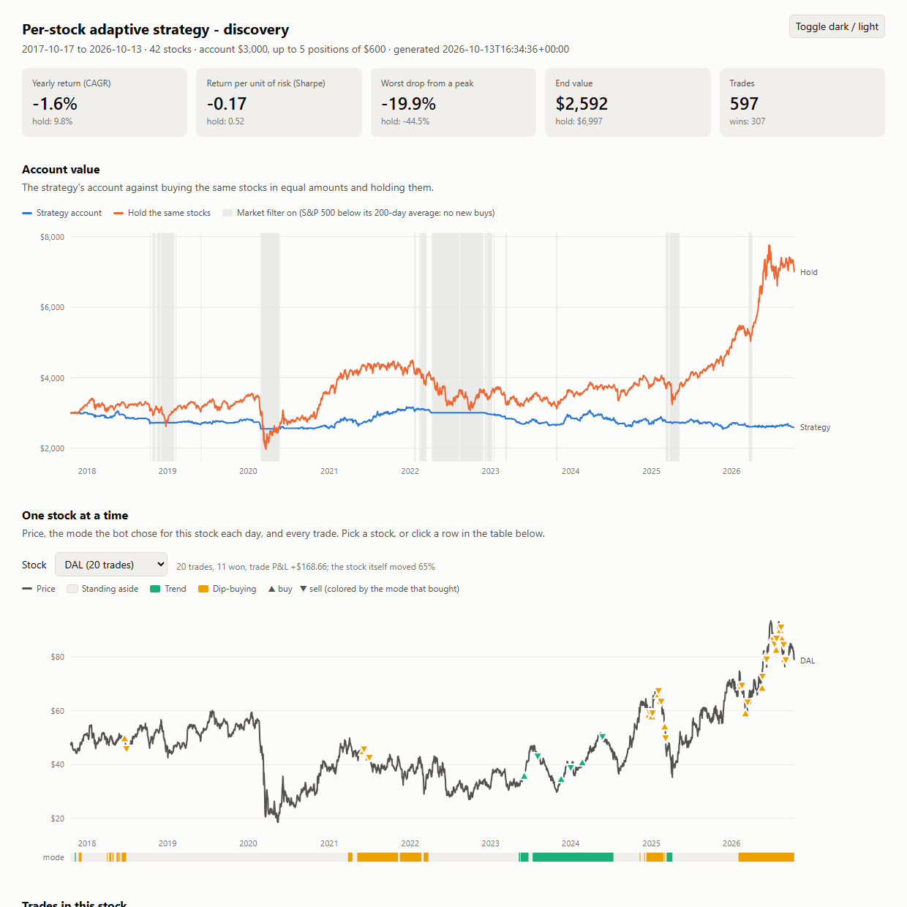
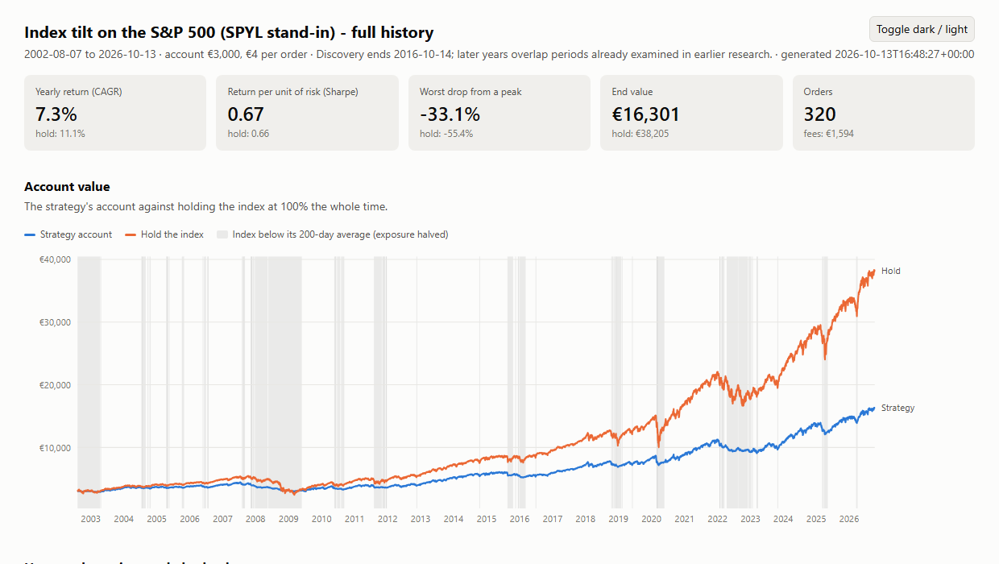

# IBKR Trading Bot & Strategy Research

An automated trading system for Interactive Brokers, built in Python, and a strategy-research framework designed to give honest answers. Over one intensive research cycle it tested 24 trading strategies against real market data under strict anti-overfitting rules. The conclusion: none beat simply holding an index fund once fees and Italian taxes are counted. The project ended by building the one bot the evidence supports.



## What this project demonstrates

- **Broker integration:** a live IBKR connection through `ib_insync`. Bracket orders (entry + server-side stop + target), partial fills, the fill-during-cancel race, reconnect and resync, and tagging orders so exits are found after a restart. Tested against the IBKR paper account: 18/18 checks.
- **Risk and state:** a portfolio-level risk manager with order reservations, a realized-P&L daily loss limit, per-bot blocks, and exchange-time day rolls. State is saved atomically to JSON and reconciled with the broker's positions at startup.
- **Market calendar:** NYSE holidays and half-days computed from the published rules (verified against the 2025–2026 calendars); the flatten time moves earlier on half-days.
- **Research method:** walk-forward testing, pre-registered rules committed to git *before* each first run, sealed holdout universes, a logged count of holdout looks, and benchmarks on the identical universe. The method caught several false positives that a normal backtest would have reported as profitable.
- **Data visualization:** a self-contained interactive HTML report showing account value against buy-and-hold and, per stock, the price, the daily mode the strategy chose and every trade. It has tooltips, light and dark themes, and a CVD-validated palette.
- **Testing:** 41 offline tests (pytest), including a fake `IB` built from real `ib_insync` objects, plus scripted end-to-end tests on the paper account.

## Architecture

```
            daily / 1-min bars (IBKR historical data)
                              │
                ┌─────────────▼─────────────┐
                │  Engine                   │  evaluates each Bot (Strategy × Instrument),
                │  strategies/*.py          │  scores signals by net reward-to-risk after costs
                └─────────────┬─────────────┘
                              │ candidates, best first
                ┌─────────────▼─────────────┐
                │  RiskManager              │  sizing, exposure, daily loss limit,
                │  risk.py                  │  order reservations, per-bot limits
                └─────────────┬─────────────┘
                              │ approved orders
                ┌─────────────▼─────────────┐      ┌──────────────────────┐
                │  ExecutionEngine          │◄────►│ IbkrExecutionClient  │◄──► IB Gateway
                │  execution.py             │      │ ibkr_client.py       │
                └──────┬──────────────┬─────┘      └──────────────────────┘
                       │              │
           ┌───────────▼───┐   ┌──────▼──────────┐
           │ StateStore    │   │ MarketCalendar  │
           │ state.py      │   │ market_calendar │
           └───────────────┘   └─────────────────┘
```

| Module | Role |
|---|---|
| `src/bot/engine.py` | Runs every enabled Bot and ranks BUY signals by score |
| `src/bot/strategies/` | Opening-range breakout and VWAP mean reversion, cost-aware |
| `src/bot/risk.py` | Position sizing and portfolio risk limits |
| `src/bot/execution.py` | Order lifecycle: brackets, partial fills, exits, flatten, reconciliation |
| `src/bot/ibkr_client.py` | The real broker client on `ib_insync` |
| `src/bot/state.py` | Atomic JSON persistence of risk counters, open trades and in-flight orders |
| `src/bot/market_calendar.py` | NYSE trading days and session closes |
| `scripts/accumulate.py` | The final bot: fee-aware accumulation of an S&P 500 UCITS ETF |
| `scripts/visualize.py` | Interactive HTML report from a strategy run |

The vocabulary (Bot, Strategy, Signal, Trade, Equity, Net R:R, Score) is defined in [`CONTEXT.md`](CONTEXT.md).

## Research results

Full write-up: [`docs/RESEARCH.md`](docs/RESEARCH.md).

| Family | Strategies | Verdict |
|---|---|---|
| Intraday (1-min bars) | opening-range breakout, VWAP reversion, parameter sweep | lost after costs; sweep "profit" vanished on unseen months |
| Daily swing, long and short | trend pullback, breakout, downtrend rally, breakdown | breakout's pass came from hand-picked stocks; +$19 on 30 fresh ones |
| Portfolio rotation | cross-sectional momentum (8 variants) | a 54%/yr result turned out to be selection bias; 0/8 pass on a fair universe |
| Index timing and multi-asset | turn of month, pre-holiday, RSI(2), dual momentum, 10-month trend | the one holdout pass was beaten by a fixed mix of the same funds |
| Adaptive | regime switch, performance switch, ensemble, per-stock adaptation | all failed on fresh stocks |
| Low turnover | Halloween seasonality, low volatility, volatility-targeted index tilt | Halloween passed (13/19 countries) as a *risk reducer*, but returned 3.6%/yr after Italian tax against 8.7% for holding |
| Contribution timing | invest at once vs wait for dips | waiting lost in 15/19 countries |



**Takeaways**

- **Selection bias is the biggest trap.** Every impressive result came from stocks chosen with hindsight; a benchmark on the *identical* universe and a fresh-stock holdout exposed each one.
- **Fixed per-order fees dominate small accounts.** At €300, even one order a month costs more than a typical year's edge.
- **Taxes matter as much as fees.** Italy taxes ETF gains at 26% on each sale, and ETF losses cannot offset later ETF gains. Any strategy that sells regularly gives up the compounding that buy-and-hold keeps.

## The final bot

`scripts/accumulate.py` buys SPYL (SPDR S&P 500 UCITS, Xetra, EUR) with spare cash and never sells:

- it places an order only when the fee is at most 0.5% of it
- it estimates the EUR price from the London listing and EUR/USD, because the account has no Xetra data
- it sends a limit order through SMART routing (direct routing is blocked by the API's precautionary settings, error 10311)
- it only previews by default; it needs `--execute` to place an order and `--live` for the live account

## Running it

```bash
python -m venv .venv && .venv/bin/pip install -r requirements-dev.txt
cp config/config.example.yaml config/config.yaml   # then edit
.venv/bin/python -m pytest                          # 41 offline tests

# with IB Gateway running on the paper account (port 4002):
.venv/bin/python scripts/paper_execution_test.py    # end-to-end order checks
.venv/bin/python scripts/download_daily.py SPY --years 25
.venv/bin/python scripts/stock_adaptive.py --dump data/viz/run.json
.venv/bin/python scripts/visualize.py data/viz/run.json   # -> reports/run.html
.venv/bin/python scripts/accumulate.py              # preview an accumulation order
```

Market data is not included; the download scripts fetch it from IBKR.

## Tech

Python 3.12 · ib_insync · pandas · numpy · pytest · vanilla JS/SVG for the reports · IB Gateway on Windows with the bot in WSL (mirrored networking).

## Notes

- Built with AI pair-programming tools (Qwen Code, Claude Code). I set the goals and research method, reviewed the changes, and ran and checked the tests and paper-trading results.
- This is a research and engineering project, not financial advice. All results are simulations on historical data.
