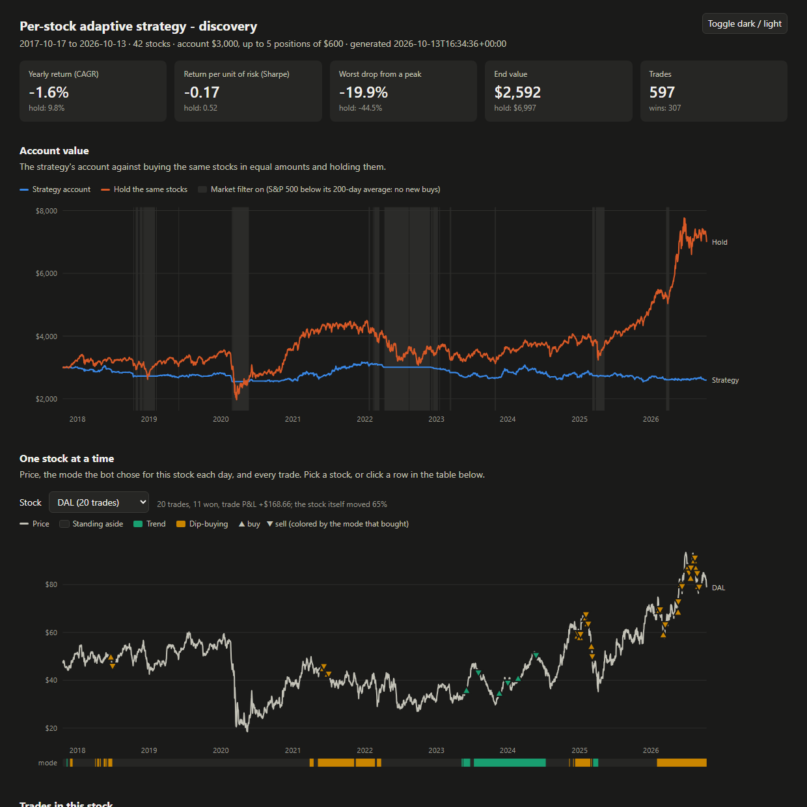
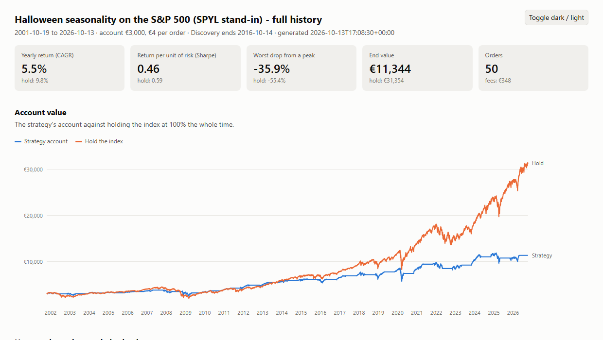

# Strategy research log

October 2026, US equities and UCITS ETFs through Interactive Brokers, for a small Italian cash account (a few hundred euros). All amounts are simulations on historical data.

## Method

Each round of testing tightened the method after a false positive slipped through the one before.

1. **Real costs.** IBKR commissions (US: max($0.35, $0.0035/share); Xetra: €1.25–€4 per order) plus slippage. Pass marks are judged with costs **doubled**.
2. **Out-of-sample testing.** Walk-forward: parameters are chosen on a train window and only test-window trades are reported.
3. **Pre-registration.** From the index research onward, each research script was committed to git **before its first run**, with rules, thresholds, costs and pass marks written in its docstring. Changing them after seeing results is not allowed; a new idea becomes a new entry.
4. **Sealed holdouts.** A strategy gets one look at data nobody had examined, and only after passing on the discovery data. Every look is logged (`data/holdout_log.csv`). Holdouts used:
   - S&P 500 2016–2026 for index strategies
   - S&P 500 "A" tickers (41 stocks), chosen mechanically and downloaded only after the rules were committed
   - 19 country index funds
   - S&P 500 "B"/"C" tickers, still sealed
5. **Fair benchmarks.** Buy-and-hold of the *identical* universe, so survivorship and selection bias affect both sides equally.

## 1. Intraday strategies (1-minute bars)

Opening-range breakout and VWAP mean reversion on 12 US stocks, 64 days, whole shares, simulated $300 account.

- **Result:** all 23 stock/strategy combinations that traded lost after costs. Gross −$45, costs $207, net −$252 over 273 trades. 66% of trades ended at the stop and only 5% reached the target.
- **Parameter sweep:** +$17 on the 64 days it was tuned on, −$46 on the three unseen months before.

## 2. Daily swing strategies, long and short

Walk-forward (2 years train, 6 months test) on 10 years of daily bars.

| Strategy | Side | Trades | Net | Net at 2× costs |
|---|---|---|---|---|
| breakout | long | 520 | +$1,286 | +$808 |
| trend_pullback | long | 1,396 | −$874 | −$2,153 |
| downtrend_rally | short | 1,094 | −$967 | −$2,001 |
| breakdown | short | 357 | −$1,569 | −$1,974 |

- **Breakout's profit came entirely from the original 12 stocks**, which had been screened for recent volatility. On 30 fresh stocks it made +$19 (−$333 at doubled costs).
- **With one position at a time** (the real account), it was 39 trades and +$455 over seven years; without its best 3 trades, +$23.
- **Short sides** lost in every year except 2020. A cash account cannot short anyway.

## 3. Monthly momentum rotation

The top 3 or 5 stocks by 6- or 12-month momentum, as one portfolio.

- **First run: 54% a year, 8/8 variants passing.** The cause was selection bias: momentum could buy PLTR, HOOD, SOFI and MU, which were in the pool because their runs were already known, while the benchmark could not.
- **On the benchmark's own universe** (and after fixing a bug where stocks leaving the top N were never sold): **0/8 pass.**

## 4. Index timing and multi-asset (pre-registered, sealed holdout)

Discovery 2001–2016, holdout 2016–2026.

| Strategy | Discovery | Holdout CAGR / Sharpe / max DD |
|---|---|---|
| turn_of_month, pre_holiday, rsi2_index | FAIL | sealed |
| dual_momentum | PASS (barely) | FAIL: 9.9% / 0.65 / −34% |
| trend_10m (SPY/EFA/AGG/GLD) | PASS | PASS (barely): 6.6% / 0.91 / −12% |
| *SPY buy-and-hold* | | *15.6% / 0.90 / −34%* |
| *fixed 25% mix of the same four* | | *10.1% / 0.98 / −19%* |

The timing rule added nothing over the fixed mix except a smaller drawdown.

## 5. Adaptive strategies (fresh-stock holdout)

A trend breakout and dip buying combined three ways, with a market filter: regime switch (Kaufman efficiency ratio), performance switch (recent shadow trades), and an ensemble as the control. A fourth version adapted per stock (variance ratio plus that stock's trailing results) with volatility-based sizing.

| Variant ($3,000, 5 slots) | Discovery | Holdout (41 fresh stocks) |
|---|---|---|
| regime_switch | 15.1% | **4.2%** |
| performance_switch | 0.3% (FAIL) | sealed |
| ensemble | 12.4% | **6.1%** |
| per-stock adaptive | −1.6% (FAIL) | sealed |
| *equal-weight hold* | *9.7%* | *16.1%* |

The visualizer showed why the per-stock version lost: it stood aside 50–76% of the time while the stocks rose.

## 6. Low-turnover strategies

| Strategy | Result |
|---|---|
| Volatility-targeted index tilt (25–100% exposure) | FAIL. About 12 orders a year; 4.5% vs 8.0% hold. On a few-hundred-euro account, fees wipe it out |
| Low volatility (5 calmest stocks, quarterly) | FAIL. 3.5% vs 9.7% |
| **Halloween** (hold November–April) | **PASS:** 13/19 countries beat buy-and-hold on Sharpe; median max DD −39% vs −65% |

Halloween is a real risk reducer, but it makes less money: median CAGR 6.8% vs 8.3%. After Italian tax (26% on every April sale; ETF losses cannot offset ETF gains), the S&P 500 over 2001–2026 gives **3.6%/yr against 8.7%/yr** for holding.

## 7. Contribution timing

Simulated scenario: €300 to start plus €100 a month, never selling, S&P 500 2001–2026, €4 per order:

| Rule | Paid in | After 26% tax |
|---|---|---|
| Invest once cash ≥ €800 (fee ≤ 0.5%) | €30,300 | **€136,693** |
| Wait for a 10% dip (max 12 months) | €30,300 | €132,195 |

Waiting for dips also lost in 15/19 countries.

## Conclusion

24 strategies, 5 logged holdout looks, 1 holdout pass (as a risk reducer only). For a small, taxable, cash account, buying and holding a broad index fund, with fee-aware order sizes and no selling, beat every active rule tested. `scripts/accumulate.py` implements exactly that.
